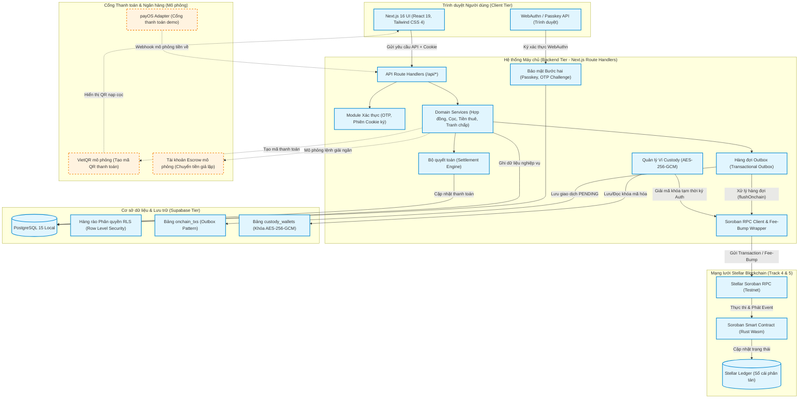
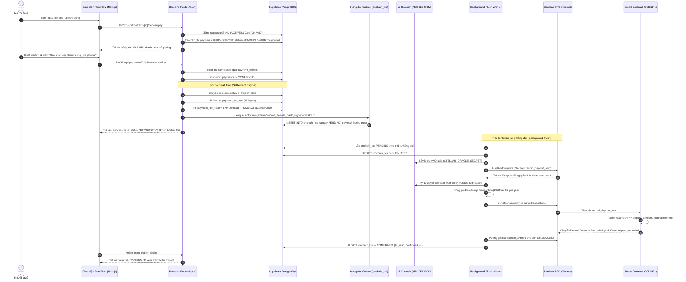
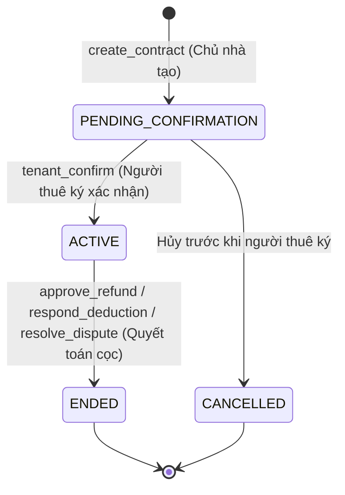
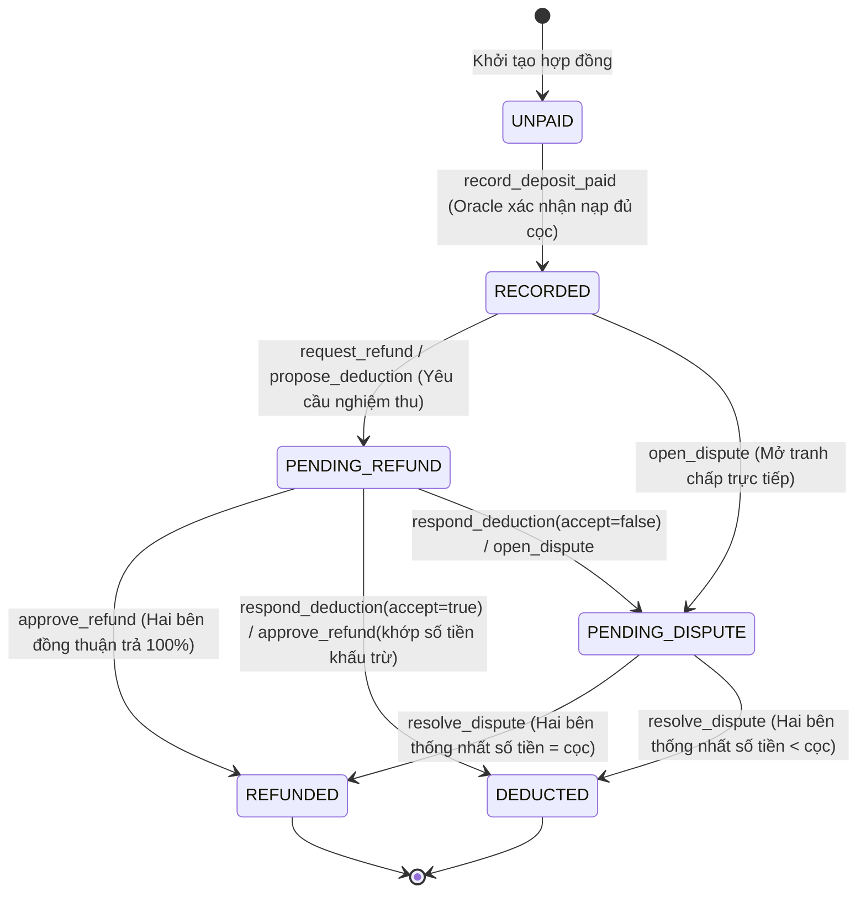
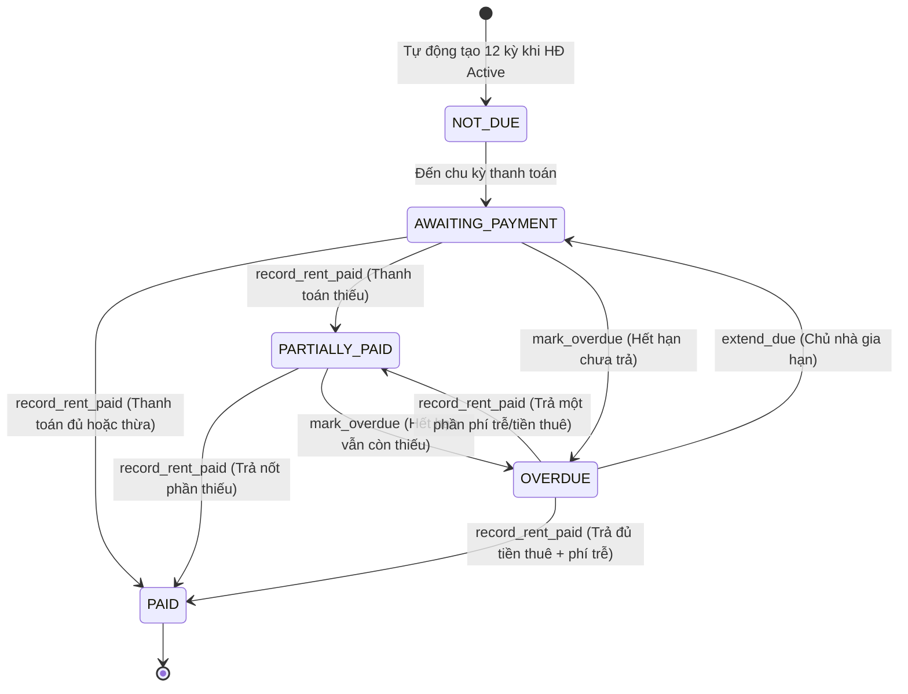
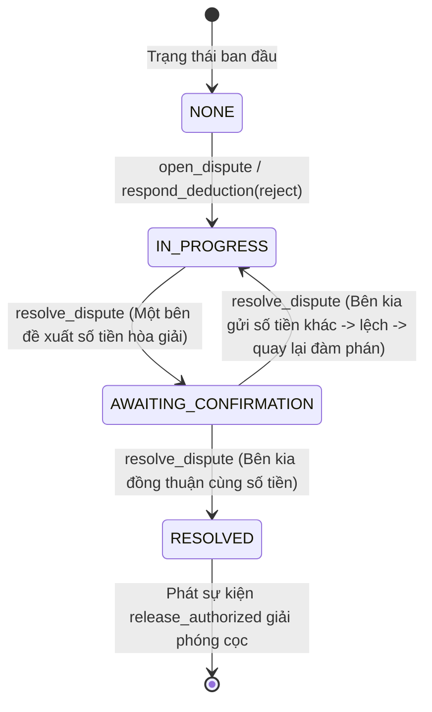
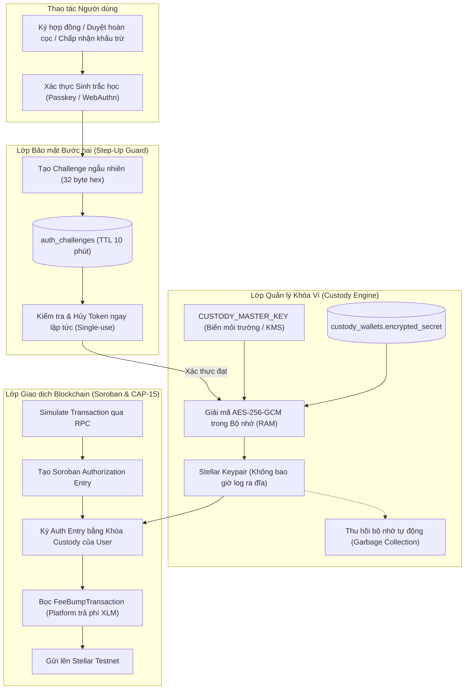

# Kiến trúc Hệ thống RentFlow

Tài liệu kiến trúc kỹ thuật của hệ thống **RentFlow** — Dịch vụ bảo chứng tiền cọc và thu tiền thuê nhà tự động, kết hợp Track 4 (Ví chuyên biệt, Custody) và Track 5 (Soroban Smart Contract) trên nền tảng Stellar Testnet.

---

## 1. Kiến trúc tổng thể hệ thống

Hệ thống kết hợp giữa kiến trúc ứng dụng Web hiện đại (Next.js 16, Supabase) và sổ cái phân tán Stellar Soroban, trong đó luồng thanh toán và ngân hàng nội địa được mô phỏng có nhãn minh bạch.

> [!NOTE]
> **Hiện trạng triển khai thực tế so với mô phỏng:**
> - **Chạy thật 100%:** Smart contract Soroban trên Stellar Testnet (WASM Rust 29.0.1); hàng đợi Outbox tự động thử lại; ví custody mã hóa AES-256-GCM; ký xác thực WebAuthn (Passkey) trên thiết bị ảo; cơ sở dữ liệu Supabase kèm chính sách RLS chặt chẽ; Fee-Bump transaction (CAP-15) do nền tảng tài trợ phí.
> - **Mô phỏng (Mock):** Ngân hàng, mã VietQR, xác nhận tiền về, tài khoản ký quỹ escrow ngân hàng và lệnh giải ngân VND hoàn toàn là **mô phỏng**. OTP đăng nhập cố định mã `123456` cho tài khoản demo (chưa đấu nối SMS gateway thực tế). payOS có mã adapter nhưng chạy ở chế độ mô phỏng (`PAYMENT_MODE=simulated`).

---

## 2. Bảng phân bổ dữ liệu: Off-chain vs On-chain

Hệ thống tuân thủ nguyên tắc đạo đức cốt lõi của Blockchain: **Tuyệt đối không đưa dữ liệu nhận dạng cá nhân (PII) lên sổ cái công khai**.

| Dữ liệu | Vị trí lưu trữ | Cơ chế bảo vệ / Định dạng | Lý do thiết kế |
|---|---|---|---|
| **Họ tên, SĐT, Email** | Off-chain (Supabase) | Bảng `profiles`, mã hóa đường truyền TLS, phân quyền RLS theo `auth.uid()`. | Tránh vi phạm quyền riêng tư vĩnh viễn trên sổ cái phi tập trung; tuân thủ quy chuẩn bảo vệ dữ liệu. |
| **Văn bản hợp đồng & Điều khoản** | Off-chain (Supabase) | Bảng `rental_contracts.terms_text`, `room_label`. | Văn bản chứa địa chỉ phòng, số nhà, thông tin cá nhân; dung lượng lớn gây tốn phí lưu trữ ledger. |
| **Mã băm hợp đồng (`doc_hash`)** | **Cả hai** (DB & On-chain) | Chuẩn hóa Canonical JSON, SHA-256 có muối ngẫu nhiên 32 byte (`doc_salt`). Lưu dạng `BytesN<32>`. | Bằng chứng bảo chứng toàn vẹn (immutability). Hai bên có thể tự kiểm chứng mà không lộ nội dung hợp đồng ra bên thứ ba. |
| **Muối của hợp đồng (`doc_salt`)** | Off-chain (Supabase) | 32 byte hex ngẫu nhiên (`rental_contracts.doc_salt`). Chỉ chủ nhà và người thuê được đọc. | Ngăn chặn tấn công dò ngược (rainbow table / brute-force) đối với các hợp đồng có nội dung ngắn hoặc theo mẫu chung. |
| **Số tiền cọc & Tiền thuê** | **Cả hai** (DB & On-chain) | DB: `bigint` (VND); On-chain: `i128`. | Smart Contract cần số tiền số nguyên để thực thi điều kiện logic (khấu trừ không vượt quá cọc, đối soát hoàn cọc, tính phí trễ). |
| **Ngày thanh toán & Phí trễ** | **Cả hai** (DB & On-chain) | DB: `due_day`, `late_fee_bps_per_day`; On-chain: `u32`. | Thực thi tính toán phí trễ minh bạch (`calc_late_fee`) và tự động hóa quy tắc gia hạn (`extend_due`). |
| **Mã tham chiếu thanh toán** | Off-chain (Supabase) | DB: `payments.order_code` (số nguyên duy nhất từ cổng thanh toán). | Tránh lộ mã định danh ngân hàng nội địa lên sổ cái quốc tế. |
| **Mã băm thanh toán (`payment_ref_hash`)** | **Cả hai** (DB & On-chain) | SHA-256(salt \|\| `provider:order_code`), lưu dạng `BytesN<32>`. | Smart Contract ghi nhận tiền cọc/tiền thuê (`record_deposit_paid`, `record_rent_paid`) và chặn gửi trùng (replay attack). |
| **Lý do khấu trừ dạng chữ** | Off-chain (Supabase) | Bảng `deduction_requests.reason_text`. | Lý do có thể chứa thông tin nhạy cảm giữa hai bên (hỏng hóc, sự cố cá nhân). |
| **Mã băm lý do (`reason_hash`)** | **Cả hai** (DB & On-chain) | SHA-256(salt \|\| `reason_text_NFC_LF`), lưu dạng `BytesN<32>`. | Minh chứng ràng buộc landlord không thể tự ý thay đổi lý do sau khi đã đề xuất khấu trừ cọc. |
| **Trạng thái HĐ, Cọc, Kỳ thuê, Tranh chấp** | **Cả hai** (DB & On-chain) | Enum u32 ánh xạ 1-1 với TypeScript (`states.ts` và `types.rs`). | Đồng bộ trạng thái thực thi: Smart contract là nguồn sự thật tối thượng cho tranh chấp và giải ngân. |
| **Khóa bí mật ví người dùng** | Off-chain (Supabase) | Mã hóa đối xứng AES-256-GCM với `CUSTODY_MASTER_KEY`, IV 12 bytes, Tag 16 bytes. | Giữ hộ ví cho người dùng không rành Web3, nhưng tuyệt đối không lộ lên mạng hay client. |
| **Địa chỉ công khai Stellar (`Address`)** | **Cả hai** (DB & On-chain) | Dạng chuỗi Base32 `G...` (Stellar Public Key). | Định danh thực thể ký duyệt trong Soroban Auth Entry. |

---

## 3. Sơ đồ tuần tự nạp cọc: Quét VietQR mô phỏng đến xác nhận Testnet

Quy trình nạp cọc mô phỏng bảo đảm tính nhất quán giữa trạng thái thanh toán off-chain và sự kiện ghi nhận trên sổ cái Stellar.

---

## 4. Máy trạng thái (State Machines)

Toàn bộ hệ thống được kiểm soát bởi 4 máy trạng thái chính. Thứ tự các trạng thái được ánh xạ chính xác giữa `src/domain/states.ts` và `contracts/rentflow/src/types.rs`.

### 4.1 Hợp đồng (`ContractStatus`)
- `0`: `PENDING_CONFIRMATION` (Chờ xác nhận)
- `1`: `ACTIVE` (Đang hiệu lực)
- `2`: `ENDED` (Đã kết thúc)
- `3`: `CANCELLED` (Đã hủy)

### 4.2 Tiền cọc (`DepositStatus`)
- `0`: `UNPAID` (Chưa thanh toán)
- `1`: `RECORDED` (Đã ghi nhận trên chain)
- `2`: `PENDING_REFUND` (Chờ hoàn cọc)
- `3`: `PENDING_DISPUTE` (Chờ xử lý tranh chấp)
- `4`: `REFUNDED` (Đã hoàn trả đủ tiền)
- `5`: `DEDUCTED` (Đã khấu trừ theo thỏa thuận)

### 4.3 Kỳ thanh toán tiền thuê (`RentStatus`)
- `0`: `NOT_DUE` (Chưa đến hạn)
- `1`: `AWAITING_PAYMENT` (Chờ thanh toán)
- `2`: `PAID` (Đã thanh toán đủ)
- `3`: `OVERDUE` (Quá hạn)
- `4`: `PARTIALLY_PAID` (Thanh toán một phần)

### 4.4 Tranh chấp (`DisputeStatus`)
- `0`: `NONE` (Không có tranh chấp)
- `1`: `AWAITING_CONFIRMATION` (Đang chờ đối phương xác nhận số tiền)
- `2`: `IN_PROGRESS` (Đang hòa giải thương lượng)
- `3`: `RESOLVED` (Đã thống nhất kết quả giải quyết)

---

## 5. Mô hình Custody (Ví chuyên biệt) & Bảo mật

RentFlow lựa chọn mô hình **Ví lưu ký chuyên biệt do Server quản lý (Server-Managed Custody)** kết hợp cơ chế ủy quyền đa yếu tố WebAuthn/Passkey để cân bằng giữa trải nghiệm người dùng thông thường và tính an toàn của tài sản số.

### 5.1 Quy chuẩn mã hóa AES-256-GCM
- **Khóa chủ (`CUSTODY_MASTER_KEY`):** Khóa đối xứng 256-bit (32 bytes base64). Trong bản phát triển/demo được đọc từ `.env.local`; trong môi trường Production cần được bảo vệ bởi AWS KMS, Google Cloud KMS hoặc thiết bị HSM phần cứng.
- **IV (Initialization Vector):** 12 bytes ngẫu nhiên được sinh mới cho mỗi thao tác tạo ví qua `crypto.randomBytes(12)`.
- **Auth Tag:** 16 bytes authentication tag bảo vệ tính toàn vẹn (Authenticated Encryption), chống việc sửa đổi bản mã.
- **Định dạng lưu trữ:** Chuỗi chuẩn hóa `ivHex:tagHex:dataHex` trong cột `custody_wallets.encrypted_secret`.
- **Cơ chế thu hồi:** Quá trình giải mã khóa bí mật diễn ra tạm thời bên trong callback `withCustodyKeypair`, trả về kết quả và giải phóng tham chiếu khóa khỏi bộ nhớ RAM ngay sau khi ký xong.

### 5.2 Cơ chế Bước hai (Step-Up Authentication)
Để ngăn chặn các hành vi xâm nhập hoặc tấn công CSRF kích hoạt ví custody, mọi thao tác thay đổi trạng thái tài chính bắt buộc phải vượt qua bước hai:
1. **Các hành động bắt buộc:** `SIGN_CONTRACT`, `APPROVE_REFUND`, `RESPOND_DEDUCTION`, `RESOLVE_DISPUTE`, `EXTEND_DUE`.
2. **Quy trình Token dùng một lần:** Server tạo token 32 bytes ngẫu nhiên trong bảng `auth_challenges` có thời hạn tối đa 10 phút (`type=STEP_UP`).
3. **Chống Replay Attack:** Ngay khi hàm `requireStepUp` kiểm tra token thành công, bản ghi trong `auth_challenges` lập tức bị **DELETE**, bảo đảm không thể dùng lại một token cho lần thứ hai.
4. **Bypass chế độ demo:** Trong môi trường thử nghiệm với `DEMO_MODE=true`, hệ thống chấp nhận token `demo-step-up` để phục vụ các kịch bản kiểm thử tự động (e2e scripts). Cờ này bắt buộc phải tắt ở môi trường thật.

### 5.3 Cơ chế Tài trợ phí Gas (CAP-15 Fee-Bump Transaction)
- **Vấn đề:** Người dùng thông thường không có sẵn đồng XLM trên ví để trả phí giao dịch blockchain Soroban.
- **Giải pháp:** Hệ thống sử dụng cơ chế Fee-Bump (CAP-15) của giao thức Stellar:
  1. Người dùng chỉ cần ký **Soroban Authorization Entry** để xác nhận quyền hạn pháp lý/nghiệp vụ của mình đối với hợp đồng thông minh.
  2. Giao dịch gốc (`innerTx`) được bọc trong một `FeeBumpTransaction` với tài khoản nền tảng (`STELLAR_PLATFORM_SECRET`) đóng vai trò là Fee Source Account.
  3. Mạng Stellar khấu trừ phí giao dịch từ tài khoản nền tảng, hoàn toàn giải phóng người thuê và chủ nhà khỏi việc phải mua hay nắm giữ tiền điện tử.
